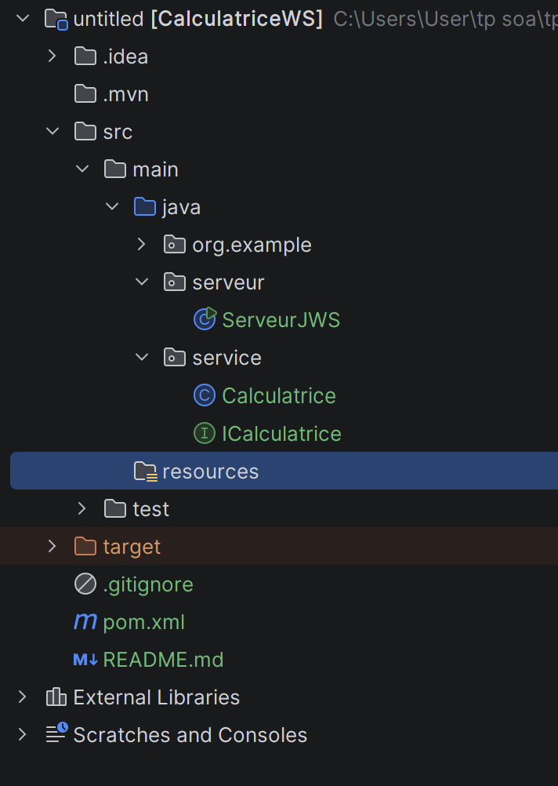
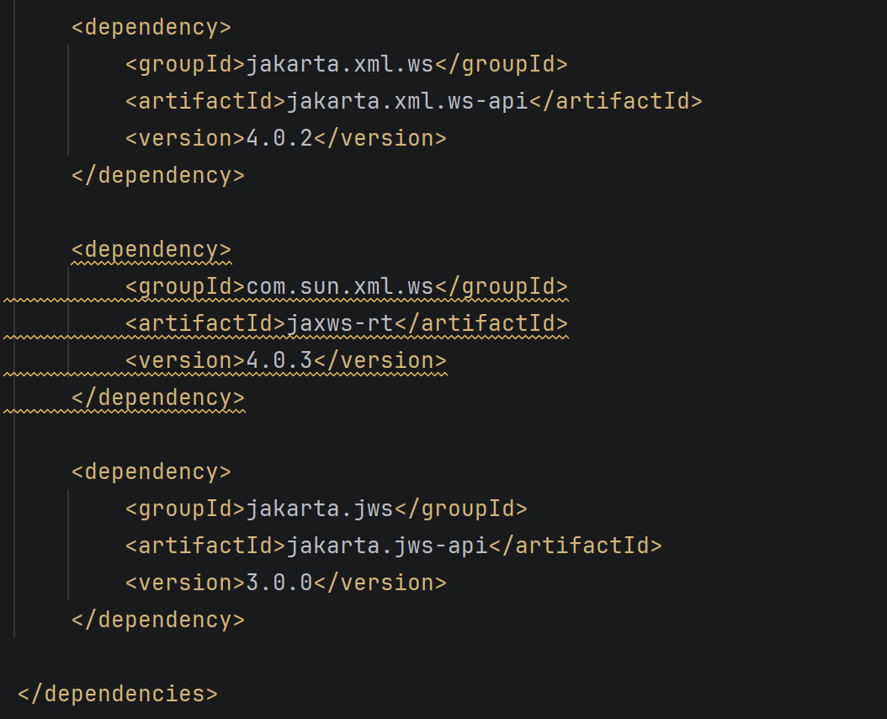
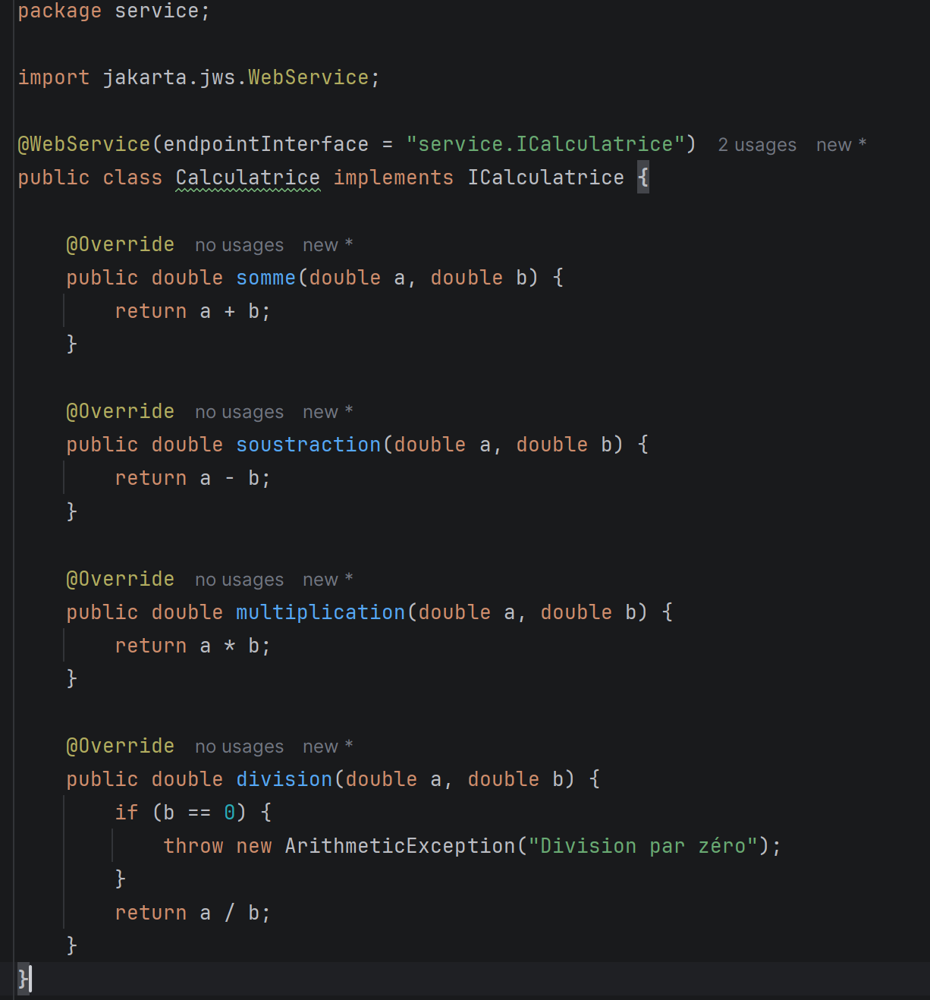
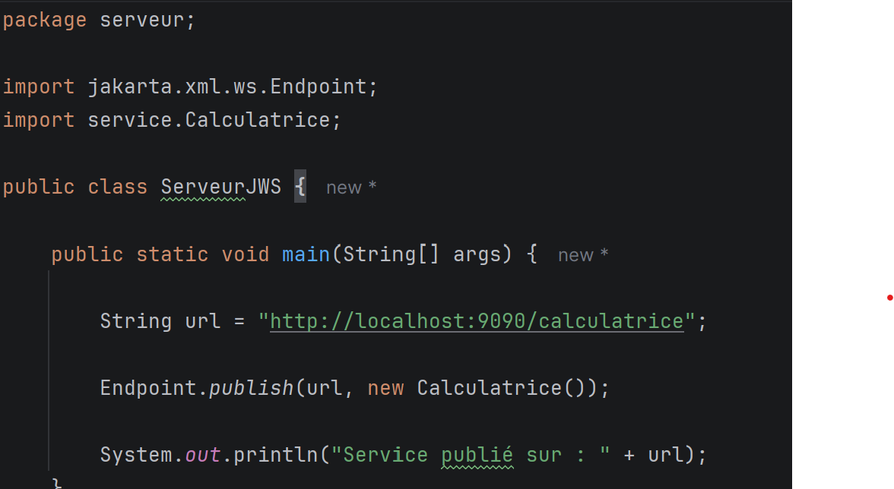
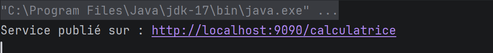
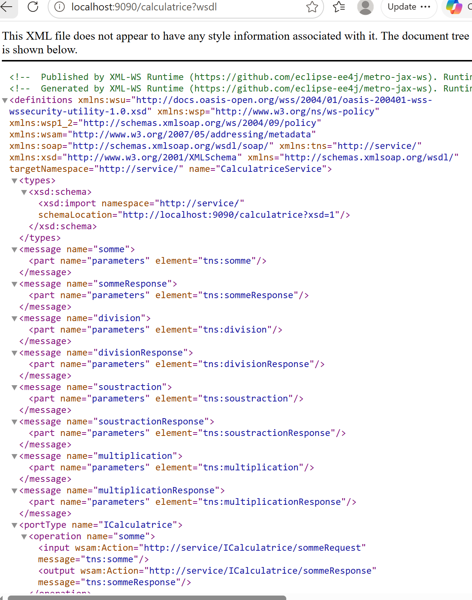
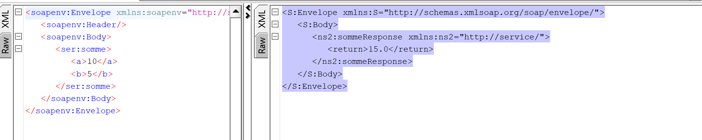
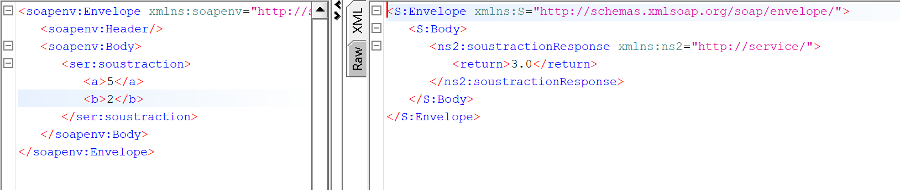
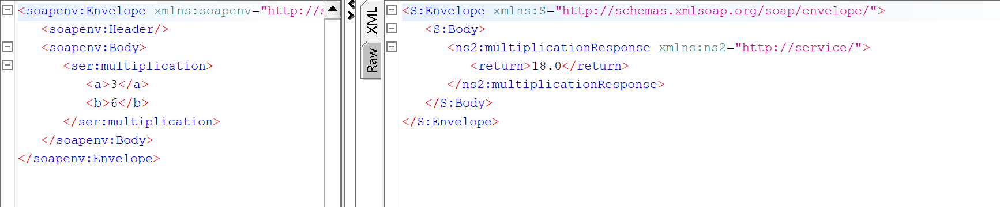
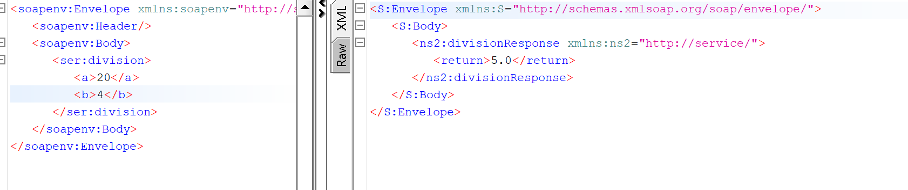

# TP2 SOAP - Calculatrice Web Service avec Jakarta XML Web Services

## Réalisé par

- Nom : RAHMA SAIDI
- Filière : LSI3
- Module : SOA et Services Web

---

# 1. Introduction

Dans ce TP, nous avons développé un service web SOAP permettant de réaliser des opérations mathématiques de base : addition, soustraction, multiplication et division.

L'objectif principal est de comprendre le fonctionnement des services web SOAP, la génération automatique du document WSDL, l'utilisation du schéma XML (XSD) ainsi que les tests à l'aide de l'outil SoapUI.

---

# 2. Objectifs du TP

Les objectifs de ce TP sont :

- Créer un service web SOAP avec Java.
- Utiliser les annotations Jakarta Web Services.
- Publier le service à l'aide de Endpoint.publish().
- Générer automatiquement le document WSDL.
- Observer le schéma XSD associé.
- Tester les opérations du service avec SoapUI.

---

# 3. Technologies utilisées

- Java 17
- Maven
- Jakarta XML Web Services
- SOAP
- WSDL
- XSD
- IntelliJ IDEA
- SoapUI

---

# 4. Structure du projet

Le projet est organisé comme suit :

src/main/java

├── service

│ ├── ICalculatrice.java

│ └── Calculatrice.java

│

└── serveur

└── ServeurJWS.java

---

## Capture 1 : Structure du projet

Capture montrant :
- service
- ICalculatrice.java
- Calculatrice.java
- serveur
- ServeurJWS.java

---

# 5. Configuration Maven

Pour utiliser Jakarta XML Web Services, plusieurs dépendances Maven ont été ajoutées dans le fichier pom.xml.

Les principales dépendances permettent :

- l'utilisation des annotations SOAP ;
- la publication du service ;
- l'exécution du moteur JAX-WS.

---

## Capture 2 : pom.xml

Capture montrant les dépendances Maven.

---

# 6. Création de l'interface ICalculatrice

L'interface ICalculatrice définit le contrat du service web.

Elle contient quatre opérations :

- somme()
- soustraction()
- multiplication()
- division()

L'annotation @WebService indique que cette interface sera exposée comme service web.

L'annotation @WebMethod permet d'exposer les méthodes.

L'annotation @WebParam permet de nommer les paramètres dans les messages SOAP.

---

## Capture 3 : Interface ICalculatrice

Capture du code source complet.

---

# 7. Implémentation de la classe Calculatrice

La classe Calculatrice implémente l'interface ICalculatrice.

Chaque méthode réalise une opération mathématique :

## Addition

Retourne :

a + b

## Soustraction

Retourne :

a - b

## Multiplication

Retourne :

a * b

## Division

Retourne :

a / b

Une vérification empêche la division par zéro afin d'éviter les erreurs d'exécution.

Cette classe représente la logique métier du service.

---

## Capture 4 : Classe Calculatrice

Capture du code complet.

---

# 8. Publication du service Web

La classe ServeurJWS contient la méthode main().

Cette classe utilise :

Endpoint.publish()

pour publier le service à l'adresse :

http://localhost:9090/calculatrice

Lors du lancement de l'application, le serveur SOAP devient accessible aux clients.

---

## Capture 5 : Classe ServeurJWS

---

# 9. Exécution du serveur

Après l'exécution de la classe ServeurJWS, le message suivant apparaît :

Service publié sur :
http://localhost:9090/calculatrice

Ce message confirme que le serveur SOAP est actif et prêt à recevoir des requêtes.

---

## Capture 6 : Exécution du serveur

👉 Capture que tu as déjà faite avec :

Service publié sur : http://localhost:9090/calculatrice

---

# 10. Génération du WSDL

Le document WSDL est accessible à l'adresse :

http://localhost:9090/calculatrice?wsdl

Le WSDL (Web Services Description Language) représente le contrat du service.

Il décrit :

- les opérations disponibles ;
- les messages échangés ;
- les types de données ;
- l'adresse du service.

Les clients SOAP utilisent le WSDL pour comprendre automatiquement comment communiquer avec le serveur.

---

## Capture 7 : WSDL généré

 Capture que tu as déjà faite dans le navigateur.

---

# 11. Analyse du XSD

Le document XSD est accessible par :

http://localhost:9090/calculatrice?xsd=1

Le XSD décrit la structure XML des requêtes et des réponses.

Il définit notamment :

- les éléments XML ;
- les types utilisés ;
- les paramètres des opérations.

Le schéma XSD garantit que les messages échangés respectent une structure valide.

---

# 12. Tests avec SoapUI

Afin de vérifier le fonctionnement du service web, plusieurs tests ont été effectués à l'aide de SoapUI.

Après importation du WSDL, SoapUI a généré automatiquement les opérations :

- somme
- soustraction
- multiplication
- division

---

# 13. Test de l'opération somme

## Requête

a = 10

b = 5

## Résultat obtenu

15

Le résultat retourné confirme le bon fonctionnement de l'opération d'addition.

---

## Capture 9 : Test addition dans SoapUI

👉 Ta dernière capture est parfaite pour cette partie.

---

# 14. Test de l'opération soustraction

## Requête

a = 10

b = 3

## Résultat obtenu

7

---

## Capture 10 : Test soustraction

👉 Faire :
- Ouvrir soustraction
- Mettre 10 et 3
- Submit
- Capture écran

---

# 15. Test de l'opération multiplication

## Requête

a = 10

b = 5

## Résultat obtenu

50

---

## Capture 11 : Test multiplication

👉 Faire :
- Ouvrir multiplication
- Mettre 10 et 5
- Submit
- Capture écran

---

# 16. Test de l'opération division

## Requête

a = 20

b = 4

## Résultat obtenu

5

---

## Capture 12 : Test division

👉 Faire :
- Ouvrir division
- Mettre 20 et 4
- Submit
- Capture écran

---

# 17. Concepts théoriques

## SOAP

SOAP (Simple Object Access Protocol) est un protocole basé sur XML permettant l'échange de données entre applications distribuées.

Il garantit une communication standardisée entre client et serveur.

---

## WSDL

Le WSDL est un document XML décrivant un service web.

Il indique :

- les opérations disponibles ;
- les messages d'entrée ;
- les messages de sortie ;
- les protocoles utilisés.

---

## XSD

XSD (XML Schema Definition) est un langage permettant de définir la structure d'un document XML.

Il garantit la cohérence et la validation des données échangées.

---

# 18. Difficultés rencontrées

Au cours de la réalisation de ce TP, plusieurs difficultés ont été rencontrées :

- Configuration des dépendances Maven ;
- Compréhension des annotations SOAP ;
- Génération automatique du WSDL ;
- Utilisation de SoapUI pour tester les opérations.

Ces difficultés ont permis une meilleure compréhension du fonctionnement des services web SOAP.

---

# 19. Conclusion

Ce TP nous a permis de découvrir la mise en œuvre complète d'un service web SOAP avec Java.

Nous avons créé un serveur SOAP, publié plusieurs opérations, généré automatiquement le contrat WSDL ainsi que le schéma XSD associé.

Les tests réalisés avec SoapUI ont confirmé le bon fonctionnement des différentes opérations proposées par la calculatrice.

Cette expérience nous a permis de mieux comprendre les concepts fondamentaux des architectures orientées services (SOA) et des services web SOAP.